<div align="center">


# SolFit

### Move · Earn · Evolve

**AI squat tracking on your phone, tied to your Solana wallet.**
On-device pose detection counts every rep. Your wallet is your account. Streaks, goals and badges follow you.

[](https://solana.digitiumlabs.com)
[](https://github.com/Nakshatra480/solfit-releases/releases/latest)


[Download](#-download) · [Features](#-features) · [Architecture](#-architecture) · [Solana](#-how-solana-is-used) · [ORE](#-ore-integration-locked-in) · [Develop](#-development)

</div>

---

<div align="center">
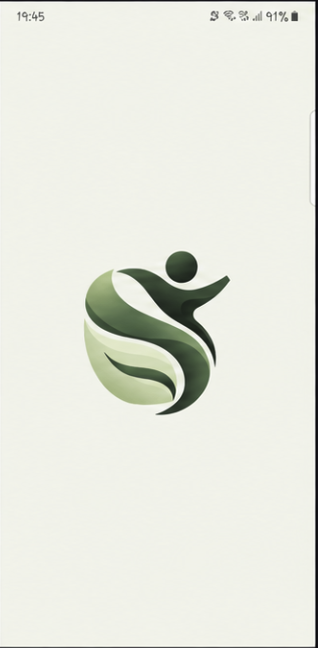
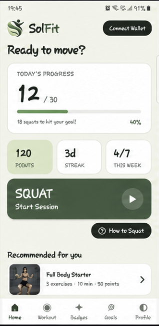
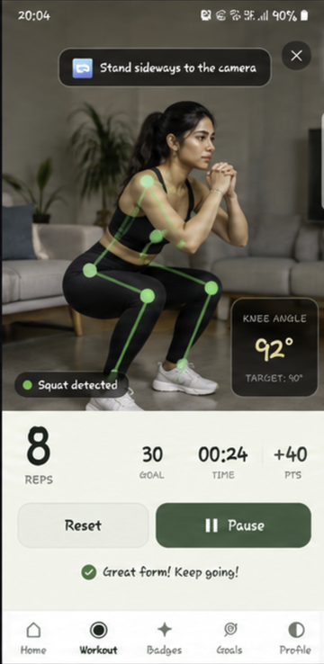
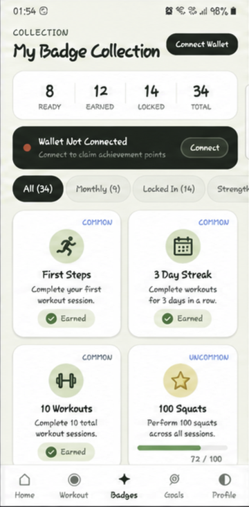
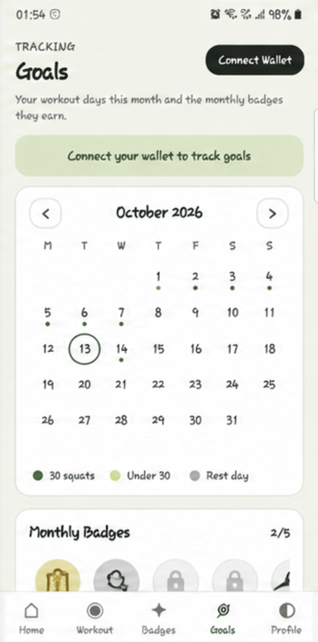
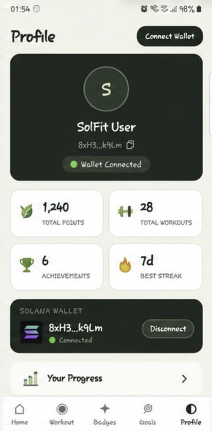
<br/>
<sub>Launch · Home · Workout · Badges · Goals · Profile (design preview with sample data, Natural Motion theme)</sub>
</div>

---

## 📲 Download

| | |
|---|---|
| **Get it** | **[solana.digitiumlabs.com](https://solana.digitiumlabs.com)** → *Download for Android* |
| **Direct APK** | [`solfit-android.apk`](https://github.com/Nakshatra480/solfit-releases/releases/latest/download/solfit-android.apk) (always the latest release) |
| **Requires** | Android 7.0+, a Solana wallet app such as Phantom or Solflare, internet for sign-in and sync |
| **Verify** | each release lists its SHA-256, and every APK is signed with the same SolFit release key |

> The APK is distributed directly by SolFit, not through Google Play. Android will ask you to allow installs from your browser the first time.

---

## ✨ Features

| | |
|---|---|
| 🎥 **Rep counting on the device** | MediaPipe Pose runs in a native Kotlin module. The camera feed never leaves the phone and is never recorded. |
| 🦵 **Clinically tuned judgement** | A rep is `knee ≤ 110°` *and* a real hip drop, then `knee ≥ 150°`. Thresholds come from physical-therapy practice and are verified against a standing-still set whose correct answer is 0. |
| 👛 **Wallet = account** | Sign In With Solana through the Mobile Wallet Adapter: one signed message, no transaction, no fee, no password. |
| 🔥 **Daily habit loop** | 30 squats a day, streaks, weekly progress and a monthly calendar. |
| 🏅 **Badges** | Lifetime milestones, streaks, monthly medals and an SKR-staker badge. Claims are recorded on Solana with a memo. |
| 🟩 **Locked In (ORE)** | A deposit-backed 3-day challenge whose reward tier is drawn from an ORE mining round. See [ORE integration](#-ore-integration-locked-in). |
| 🌿 **Natural Motion design** | Calm, readable UI with an animated launch screen and exactly five tabs: Home, Workout, Badges, Goals and Profile. |

---

## 🏗 Architecture

### High-level design

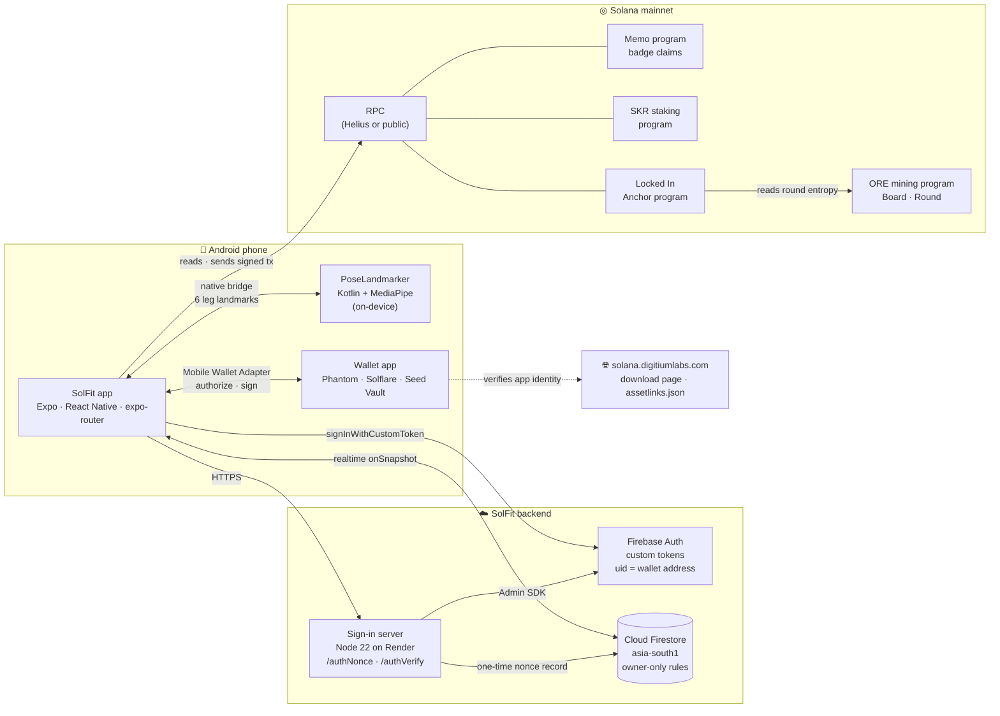

### Layers

| Layer | What runs there | Key files |
|---|---|---|
| **App shell** | Expo SDK 54, React Native 0.81 (new architecture), expo-router with 5 tabs, animated startup loader | `app/_layout.tsx`, `app/(tabs)/`, `components/StartupLoader.tsx` |
| **Pose detection** | Native `PoseLandmarker` (MediaPipe Tasks, VIDEO mode), a 100 ms snapshot loop, and a rep state machine | `android/.../PoseLandmarkerModule.kt`, `hooks/usePoseLandmarker.ts`, `app/(tabs)/workout.tsx` |
| **Wallet** | Mobile Wallet Adapter session, cached auth token, Sign In With Solana | `context/WalletContext.tsx`, `lib/signIn.ts` |
| **Identity** | Signature check, then a Firebase custom token whose uid is the wallet address | `functions/src/standalone.ts`, `functions/src/auth/` |
| **Data** | Firestore: subcollections are the source of truth, and the user document is a cache | `firestore.rules`, `hooks/*` |
| **On-chain** | Memo claims, SKR stake reads, Locked In program, ORE round reads | `lib/badgeClaim.ts`, `hooks/useSkrStaking.ts`, `onchain/`, `lib/lockedIn/` |
| **Theme** | Natural Motion tokens shared by every screen | `constants/naturalMotion.ts` |

### Workout pipeline

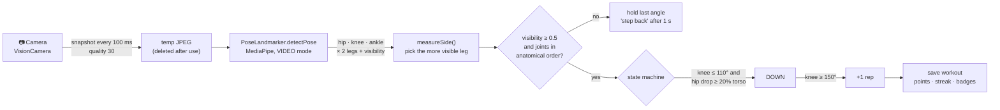

The judgement runs on the **raw angle of a single frame**: no smoothing and no multi-frame confirmation. On-device measurement showed that both cost real reps at the ~4 fps this pipeline achieves. The 0.5 confidence gate and the anatomical-order check are what stop phantom reps. Details are in [`docs/ARCHITECTURE.md`](docs/ARCHITECTURE.md).

---

## ◎ How Solana is used

| Solana service | Used for | How |
|---|---|---|
| **Mobile Wallet Adapter** | connecting the user's wallet | `transact()` → `authorize` with the app identity (name, URI, icon) on `solana:mainnet`. The auth token is cached, so later actions reauthorize silently. |
| **Sign In With Solana** | logging in without a password | The server issues a one-time nonce. The wallet signs a SIWS message bound to `solfit.digitiumlabs.com`, and the server verifies the ed25519 signature. |
| **Digital Asset Links** | proving the app is genuine | `/.well-known/assetlinks.json` pairs `com.solfit.app` with the release key's SHA-256, so wallets can show a verified identity. |
| **Memo program** | permanent badge-claim records | A claim is one transaction: a 0.001 SOL transfer plus a memo such as `solfit:badge:lifetime:<id>`. It is simulated before the wallet opens and confirmed afterwards. |
| **SKR staking program** | the SKR Staker badge | Derive the user's `UserStake` PDA, read `shares` and the pool's `share_price` (both `u128`), and award the badge at ≥ 1 SKR. That takes 2 `getAccountInfo` calls with no history scan. |
| **SPL Token** | Locked In deposits and rewards | 100 SKR deposits into a per-cohort PDA vault, and ORE rewards paid from a PDA vault. |
| **Anchor program** | Locked In rules | Deposits, success marks, picks, settlement and claims, with invariants enforced on-chain. |
| **ORE mining rounds** | fair randomness for rewards | See below. |

### Sign-in sequence

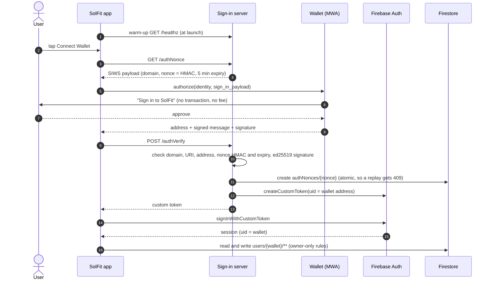

**Security properties:** no database write happens before a valid signature; nonces are single-use and expire after 5 minutes; tokens are minted only server-side; and Firestore refuses any request whose `auth.uid` isn't the wallet in the path. The mobile app ships no credentials beyond Firebase's public client config.

### Badge claim

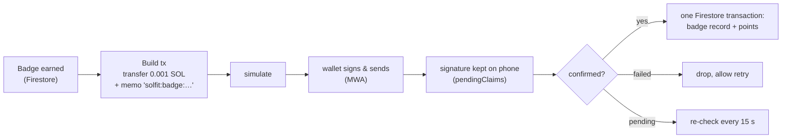

Claim IDs are fixed (`lb-<badge>`, `mb-<type>-<YYYYMM>`, `sb-<badge>-<cohort>`), so a retry can never add points twice.

---

## 🟩 ORE integration: Locked In

**Locked In** turns a 3-day squat challenge into a commitment with a fair, verifiable reward.

> Lock in **100 SKR**, which you get back 100%, pass or fail. Do 30 squats a day for 3 days. Finish, and pick one Square on a 5×5 board. An **ORE mining round** decides its tier, and the reward is paid in **ORE**.

### Flow

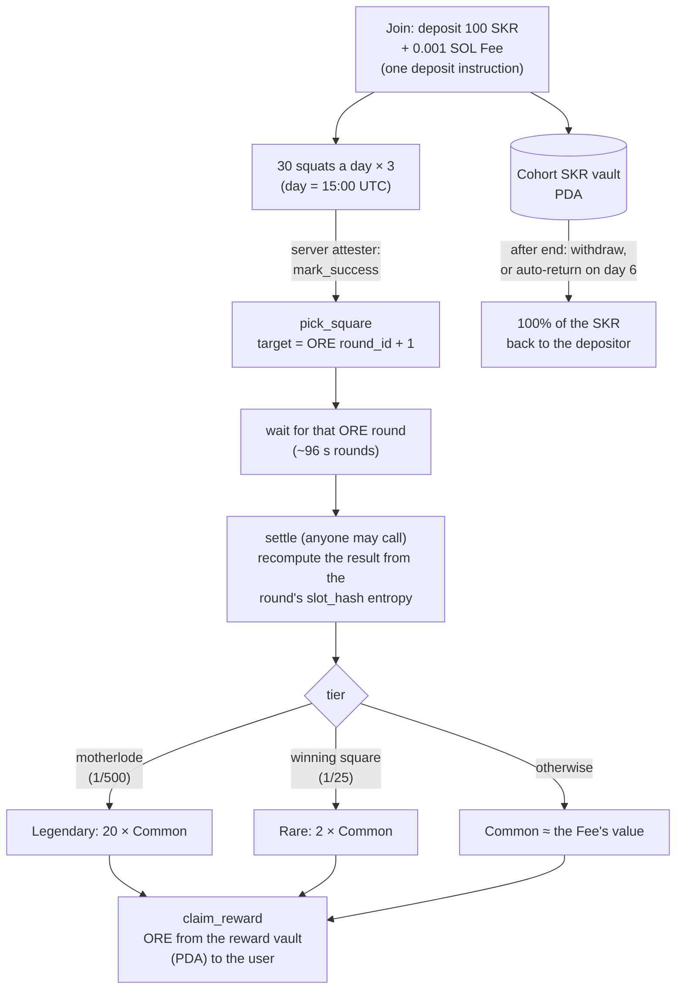

### How ORE is read, without trusting anyone

| Step | Detail |
|---|---|
| **Program** | ORE mining `oreV3EG1i9BEgiAJ8b177Z2S2rMarzak4NMv1kULvWv`, mint `oreoU2P8bN6jkk3jbaiVxYnG1dCXcYxwhwyK9jSybcp` |
| **Board** | Fixed address; `round_id` read at offset 8 to learn the current round |
| **Target round** | A pick records `round_id + 1`, so the result is unknowable when you pick |
| **Round account** | PDA `["round", id]`, 952 bytes; owner, PDA, discriminator and length are validated before reading `slot_hash` |
| **Randomness** | `rng` = XOR of `slot_hash`'s four u64 words; winning square = `rng % 25`; motherlode = `reverse_bits(rng) % 500 == 0` |
| **Settlement** | Deterministic and caller-independent; picks settle strictly in recording order; per-cohort caps are 1 Legendary and 3 Rare |
| **Edge cases** | A round with no entropy is retargeted to the next one; a round already closed pays Common (no re-draw) |

The program doesn't link `ore-api`. The round math is ported and tested against ORE's own events, and the derivation was checked across all 1,199 live Round accounts on mainnet: it flagged exactly the 3 motherlode rounds.

### On-chain guarantees

- 🔒 **Deposits only go back to the depositor.** No instruction takes a destination for SKR.
- 🔒 **Nothing leaves an SKR vault before the cohort ends.** There is no cancel instruction.
- 🔒 **The only way ORE leaves the reward vault is `claim_reward`.** There is no admin withdrawal.
- 🔒 **Rewards are reserved up front**: 52 × Common per cohort, so promised ORE can always be paid.
- 🔑 **Separated keys**: a Squads 2-of-3 admin, plus server keys for cohort creation, attestation and the crank. None of them can redirect funds.

### Status in this deployment

| Part | Status |
|---|---|
| Anchor program (`onchain/programs/locked_in`) | complete; a verified build exists on mainnet from an earlier deployment (`9vG8Qcwv…`, Squads-administered), not operated by SolFit |
| Server jobs (`onWorkoutCreate`, `everyMinute`, `daily`) | in `functions/`; **not deployed for SolFit** |
| App screens (`app/locked-in/`, `components/lockedIn/`) | included; the Home card appears only when live cohorts exist |

SolFit's production backend currently runs **sign-in only**. Running Locked In under SolFit needs its own program deployment, admin multisig, funded reward vault and server keys. The full design is in [`docs/LOCKED_IN.md`](docs/LOCKED_IN.md).

---

## 🗂 Data model

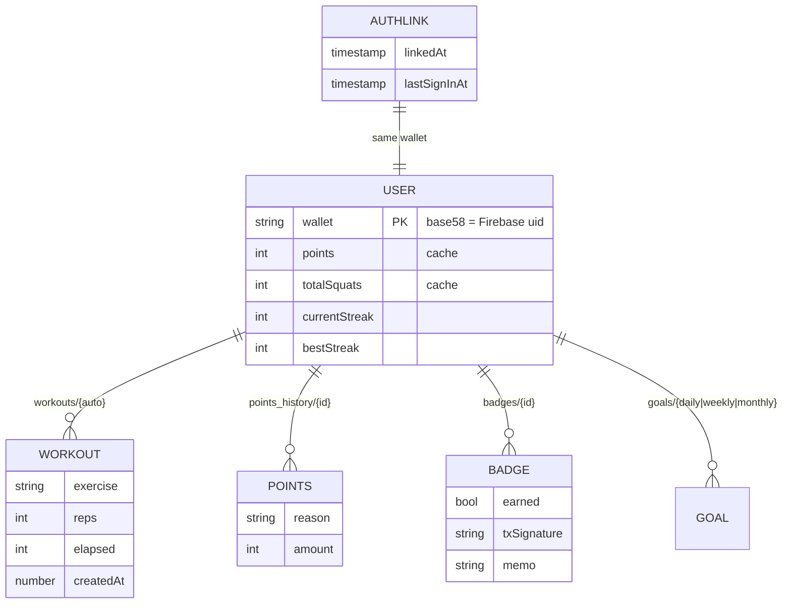

Subcollections are the **source of truth**. On connect, the app re-derives the cached totals from them. All access is owner-only (`request.auth.uid == wallet`), apart from the public quest catalog.

---

## 🧰 Tech stack

| Area | Technology |
|---|---|
| App | Expo SDK 54 (bare), React Native 0.81, TypeScript (strict), expo-router v6, React Compiler |
| Vision | MediaPipe Tasks Vision 0.10.14 (pose_landmarker_lite), react-native-vision-camera 4 |
| Solana | @solana/web3.js, @solana-mobile/mobile-wallet-adapter-protocol, SIWS |
| On-chain | Anchor (SBPFv3), SPL Token, Squads v4, solana-verify |
| Backend | Node 22 sign-in server on Render; Firebase Auth, Cloud Firestore (asia-south1); Cloud Functions v2 for Locked In |
| Web | GitHub Pages: download page and Digital Asset Links |
| Testing | node:test unit tests, Firebase emulator (rules, server, sign-in end to end), LiteSVM, Surfpool |

---

## 🛠 Development

```bash
npm install
npm --prefix functions install

npm run start                                   # Metro for the debug build
npx tsc --noEmit                                # app typecheck
npm --prefix functions run typecheck            # server typecheck
npm --prefix functions test                     # unit tests
firebase emulators:exec --only firestore,auth --project demo-solfit \
  "npm --prefix functions run test:emulator"    # rules + server tests
```

**Android builds** need JDK 17 and the Android SDK (`compileSdk 36`, NDK 27.1):

```bash
export JAVA_HOME=$(/usr/libexec/java_home -v 17)
cd android && ./gradlew assembleDebug           # debug build, served by Metro
scripts/release-android.sh                      # signed release: checks, build, verify, checksum
```

> ⚠️ Don't run `npx expo prebuild`, `npx expo run:android` or `./gradlew clean` in this repo. They can wipe gitignored native files. See [`CLAUDE.md`](CLAUDE.md).

**Configuration**

| Variable | Where | Purpose |
|---|---|---|
| `EXPO_PUBLIC_AUTH_URL` | app build | sign-in server URL; the release script sets it |
| `EXPO_PUBLIC_HELIUS_API_KEY` | app build (optional) | faster RPC; falls back to the public endpoint |
| `AUTH_NONCE_SECRET(_FILE)`, `GOOGLE_APPLICATION_CREDENTIALS` | sign-in server only | nonce HMAC key and service account; never in the app or git |

Releases follow [`docs/RELEASING.md`](docs/RELEASING.md).

---

## 🔐 Privacy

- The camera is processed **on the device**; frames are analysed and discarded, never recorded or uploaded.
- SolFit stores your **public** wallet address, workouts, points, streaks and badges. Only your own signed-in session can read them.
- SolFit never asks for your private key or recovery phrase, and signing in never costs SOL.

[Privacy Policy](https://solfit.digitiumlabs.com/privacy-policy.html) · [Terms of Service](https://solfit.digitiumlabs.com/terms.html)

---

## ⚠️ Known limits

- The sign-in server is on a free Render instance and sleeps when idle. The app wakes it at launch, but the first sign-in after a long idle can take up to a minute.
- SolFit needs the network to sign in and sync, and is **Android only**.
- Side-view capture only: stand side-on, with shoulder to ankle in frame.

---

## 📄 License

Released under the MIT License. See [LICENSE](LICENSE).

<div align="center">
<br/>

<br/>
<sub>Built on Solana · Powered by on-device AI · Rewards drawn from ORE rounds</sub>
</div>
